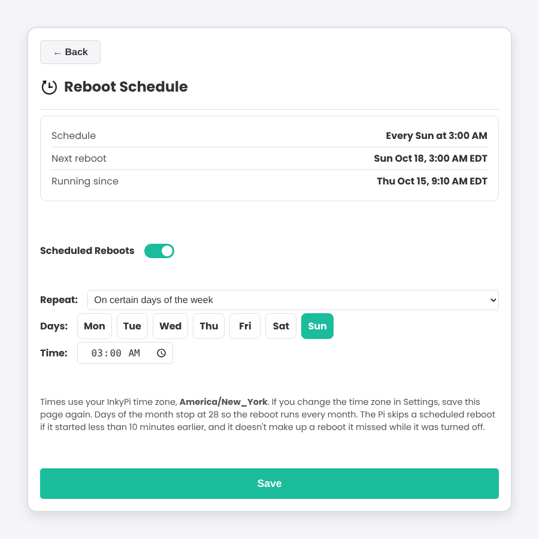
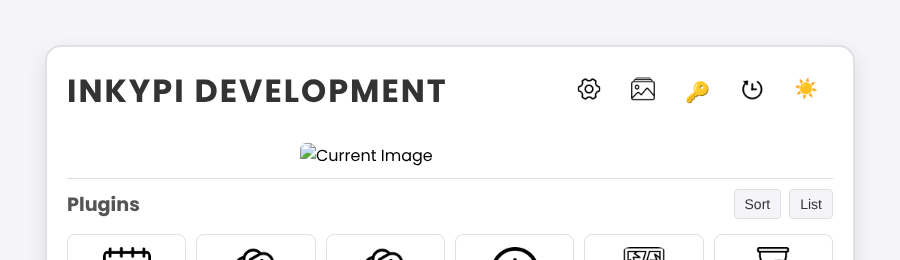

# InkyPi Reboot Schedule

Adds scheduled reboots to [InkyPi](https://github.com/fatihak/InkyPi). A clock icon at the top of the InkyPi main page opens a page where you can set reboots for every day, chosen days of the week, or once a month.





## Install

On the Pi:

```bash
git clone https://github.com/raj-gitsome/inkypi-reboot-schedule.git ~/inkypi-reboot-schedule
sudo bash ~/inkypi-reboot-schedule/install.sh
```

Then reload the InkyPi web page and click the clock icon.

The installer finds InkyPi through `/usr/local/inkypi/src`, which InkyPi's own installer creates. If InkyPi lives somewhere else, run `sudo INKYPI_SRC=/path/to/InkyPi/src bash install.sh`.

## Update

```bash
cd ~/inkypi-reboot-schedule && git pull && sudo bash install.sh
```

## Remove

```bash
sudo bash ~/inkypi-reboot-schedule/uninstall.sh
```

This also turns off any scheduled reboot.

## How it works

- Reboots are run by a systemd timer (`inkypi-reboot.timer`), not by the InkyPi app, so they still happen if InkyPi has frozen.
- Times use the time zone set in InkyPi's Settings. If you change it there, click Save on the Reboot Schedule page again.
- The Pi skips a scheduled reboot if it has been up for less than 10 minutes, which prevents reboot loops. It doesn't make up reboots it missed while it was off.
- Days of the month stop at 28 so the reboot runs every month.
- The schedule is saved in InkyPi's `device.json` under `reboot_schedule`.

Useful commands:

```bash
systemctl list-timers inkypi-reboot.timer   # next scheduled reboot
journalctl -u inkypi-reboot.service         # past scheduled reboots
```

## What the installer changes

It copies three new files into InkyPi:

- `src/blueprints/reboot_schedule.py`
- `src/templates/reboot_schedule.html`
- `src/static/icons/reboot_schedule.png`

It also adds two lines to `src/inkypi.py` to register the page, and the icon link to `src/templates/inky.html`. Running the installer more than once is safe, and `uninstall.sh` removes everything.

### Updating InkyPi

If `git pull` complains about those two edited files when you update InkyPi, undo the edits first, update, and then run the installer again:

```bash
cd ~/InkyPi
git checkout src/inkypi.py src/templates/inky.html
git pull
sudo bash ~/inkypi-reboot-schedule/install.sh
```

Your schedule keeps running throughout.

## License

GPL-3.0, the same license as InkyPi.
